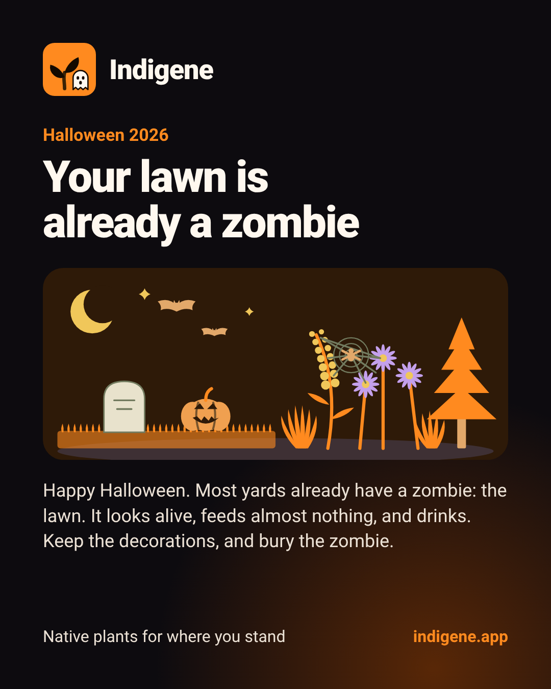
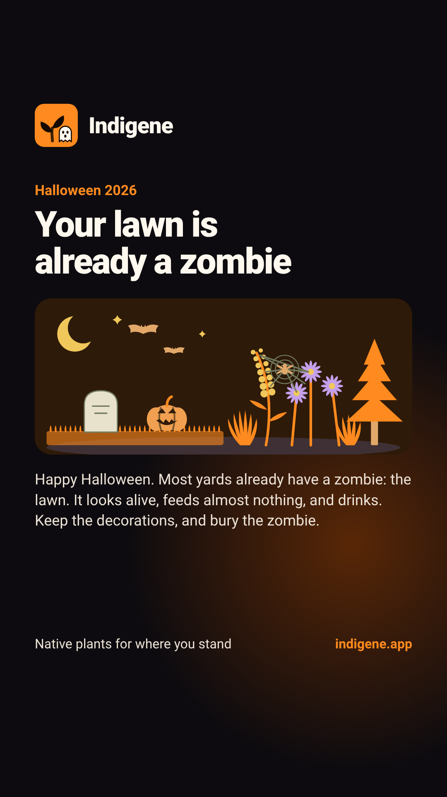

# Halloween 2026: Instagram template

The Halloween post, [indigene.app/posts/halloween-2026](https://indigene.app/posts/halloween-2026),
sends people to the guide that stays up all year,
[indigene.app/kill-your-lawn](https://indigene.app/kill-your-lawn). The caption
links the guide: it's the page that answers "what do I plant?", in April too.

Images are drawn from the post's own words and drawing, in the spooky theme's
colours and ghost mark, so they can't drift from the page:

```sh
cd app
node scripts/gen-story.mjs halloween-2026 --feed            # feed post, 1080×1350
node scripts/gen-story.mjs halloween-2026                   # story, 1080×1920
node scripts/gen-story.mjs halloween-2026 --feed --lang fr  # French versions
node scripts/gen-story.mjs halloween-2026 --lang fr
```

| Feed post | Story |
|---|---|
|  |  |

**When:** 31 October, morning. The story goes up the same day with a link
sticker in the clear band under the text.

## Feed caption (English)

> Your lawn is already a zombie. 🧟
>
> It looks alive, feeds almost nothing, and drinks: an American household uses
> more water outdoors than for showers and laundry together.
>
> This Halloween, bury it. Cardboard, wood chips, wait for spring. Then plant
> what feeds the caterpillars, bees and birds: wildflowers, shrubs, trees, and
> evergreens for the dead of winter.
>
> Easy natives for your region: link in bio → indigene.app/kill-your-lawn
>
> 🎃 Keep the inflatable ghoul. Just put the lights on a timer, off at 11 pm:
> birds migrate at night by the stars. 🕸️ And keep the fake cobwebs indoors.
>
> #KillYourLawn #NativePlants #Halloween #SheetMulching #HomegrownNationalPark #NoMowMay

## Légende (français)

> Votre pelouse est déjà un zombie. 🧟
>
> Elle a l'air vivante, ne nourrit presque rien, et elle boit.
>
> Pour Halloween, enterrez-la : du carton, des copeaux, et attendez le
> printemps. Puis plantez ce qui nourrit chenilles, abeilles et oiseaux :
> fleurs sauvages, arbustes, arbres, et des persistants pour le cœur de l'hiver.
>
> Des plantes indigènes faciles pour votre région : lien en bio →
> indigene.app/kill-your-lawn
>
> 🎃 Gardez le fantôme gonflable. Mettez juste les lumières sur minuterie,
> éteintes à 23 h : les oiseaux migrent de nuit, guidés par les étoiles.
> 🕸️ Et gardez les fausses toiles d'araignée à l'intérieur.
>
> #TueTonGazon #PlantesIndigènes #Halloween #Paillage #JardinSauvage

## Alt text

> A dark card titled "Your lawn is already a zombie", Halloween 2026. A drawing:
> under a crescent moon and two bats, a flat strip of lawn holds a headstone
> and a jack-o'-lantern; beside it grow goldenrod, purple asters, a pine, and a
> spider on its web.

## Notes

- Every figure in the caption is on the post with its source (EPA WaterSense
  for the water; Will County Forest Preserve for the webs; Audubon North
  Carolina for the lights). Don't add one that
  isn't.
- The US water figure doesn't hold for every reader. The French caption leaves
  it out rather than borrow an American number.
- Keep the joke to the first line. The rest is the how-to.
